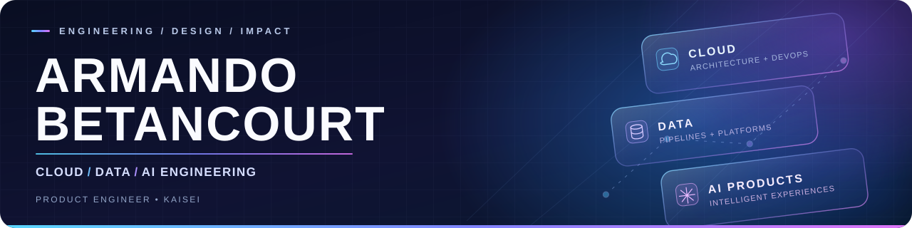
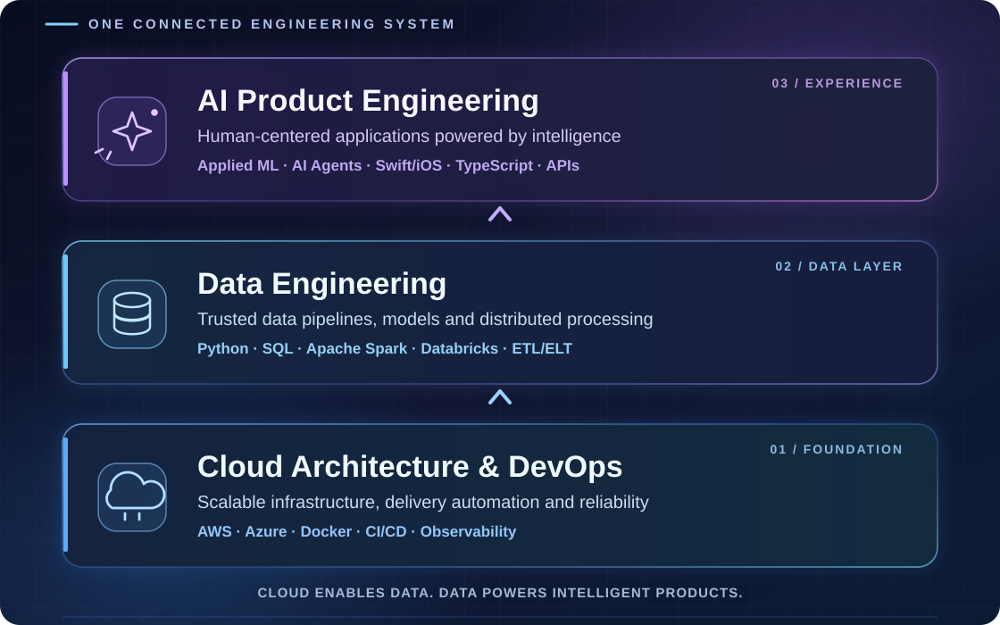

  

  
  
  

### Engineering the systems behind intelligent products.

I'm a **Software & Product Engineer** and founder at **KAISEI**. I build end-to-end technology products where **cloud infrastructure, reliable data systems and applied AI** meet thoughtful product design.

Rather than treating cloud, data and AI as separate disciplines, I work across the architecture that connects them — from backend systems and pipelines to intelligent, human-centered experiences.

## Three connected focus areas

  

## Selected engineering work

Four projects with documented implementations, reproducible tests or explicit evaluation contracts. The links below point to **versioned technical evidence**, not just product descriptions.

| Project | Engineering focus | Evidence |
| :--- | :--- | :--- |
| **[AUGUST](https://github.com/armaabetancourtt/august)** · Decision Intelligence & Risk Engine | Data pipelines, ML evaluation, forecasting and analytical APIs. | [Real-data fraud ML benchmark](https://github.com/armaabetancourtt/august/blob/6545d31007057f79c1a34e08427beb969a0544ef/docs/FRAUD_REAL_BENCHMARK.md) |
| **[Evermore](https://github.com/armaabetancourtt/evermore)** · AI-native language and runtime | Typed agent workflows, tool authorization, evaluation and deterministic testing. | [AI evaluation methodology](https://github.com/armaabetancourtt/evermore/blob/70b36ff466343912cdbfe4c608ed387261f41ebf/docs/LIVE_AI_EVALUATION.md) |
| **[PIXEL GO](https://github.com/armaabetancourtt/pixelgo)** · Cross-platform file sharing | Native iOS/Android, Go backend, realtime transport and operational testing. | [Operations evidence](https://github.com/armaabetancourtt/pixelgo/blob/6b4bcdaa34e2c72aeb43eb66d7b9c6551809db6f/docs/OPERATIONS_EVIDENCE.md) |
| **[TRACE](https://github.com/armaabetancourtt/trace)** · Geospatial mobile platform | Offline-first mobile architecture, privacy-aware data contracts and ML baselines. | [ML benchmark & data contract](https://github.com/armaabetancourtt/trace/blob/cd0024b14f226a603a43c265cb86efeacd18bc02/ml/README.md) |

Engineering note: projects may include research-stage functionality, simulated data or opt-in evaluations. Linked documentation describes what is implemented, how to reproduce it and what remains unverified; no production-scale or real-user performance is implied.

## Products with a human purpose

- **[ETERNAL](https://github.com/zeusacad/Eternal-K)** — a digital ecosystem designed to support neurodivergent users through accessibility, personalization and human-centered interactions.
- **[Changemaker](https://github.com/zeusacad/changemakerweb)** — a platform connecting young people, innovation initiatives and universities.
- **Thinki** — a native Swift/iOS EdTech app for children with ADHD. I led technical development and designed **iPart**, a participation metric intended to reduce bias; the project placed **first among ten teams** at the Accessible App & Tech Showcase.

## Engineering toolkit

| Layer | Technologies & practices |
| :--- | :--- |
| **Languages & apps** | Python · SQL · TypeScript · Java · Swift/SwiftUI · Kotlin · Dart · Bash |
| **Cloud & delivery** | AWS · Azure · Docker · GitHub Actions · CI/CD · backend APIs · observability |
| **Data & intelligence** | Databricks · Apache Spark · Pandas · NumPy · scikit-learn · TensorFlow · data modeling · ETL/ELT |
| **Product & systems** | Native mobile · realtime systems · API design · system architecture · UI/UX · human-centered design |

## Education & selected credentials

**Software Development Engineering** · Universidad Tecmilenio  
**Specialized focus track:** DevOps Methodologies *(part of the engineering degree, not a separate postgraduate qualification).*

**Databricks — accreditations & learning paths**

- [AWS Databricks Platform Architect](https://credentials.databricks.com/78da2310-47e9-41ee-a661-51929aac0fb3)
- [Advanced Techniques with Apache Spark Declarative Pipelines](https://credentials.databricks.com/f4874414-bff2-41bf-8cc9-a3058d9c85a4)
- [DevOps Essentials for Data Engineering](https://credentials.databricks.com/55bdd0a9-d095-4625-8f57-21b56a93f21e)
- Data Engineer Learning Path · Databricks Fundamentals Accreditation
- Additional learning in MLOps, AI agents and multicloud data platforms

**Additional credentials:** IBM DevOps and Software Engineering · Microsoft Certified: Azure AI Fundamentals (AI-900) · AWS Cloud Operations · Cisco Data Analytics Essentials · Red Hat System Administration I (RH124).

---

  <strong>I build products like systems, design them like stories, and ship them like they matter.</strong> 
  Thoughtful engineering. Meaningful impact.

